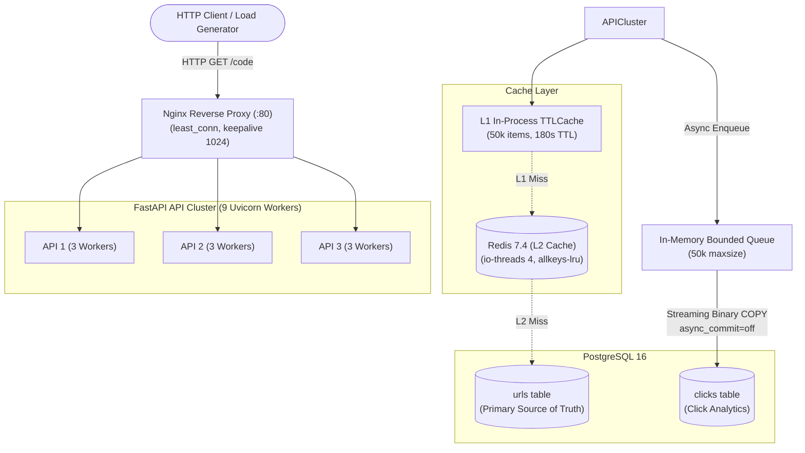

# High-Throughput URL Shortener

A high-performance, horizontally scalable URL shortener engineered with Python 3.12 (FastAPI), Redis 7.4, PostgreSQL 16, and Nginx.

### Features
- **Guaranteed Collision-Free Short Codes**: 7-character Base62 codes via disjoint block leases and a bijective 4-round Feistel cipher.
- **Multi-Tier Cache Hierarchy**: In-process L1 cache (sub-millisecond lookups), negative caching, and Redis L2 cache.
- **Asynchronous Click Analytics**: Non-blocking in-memory queue with streaming binary PostgreSQL `COPY` and per-connection async commits.
- **Production Edge Proxy**: Nginx reverse proxy with connection multiplexing, IP-based rate limiting, and in-memory microcaching.

---

## Architecture



---

## Key Design Decisions

- **ID Generation**: Disjoint 100,000-ID sequence leases from PostgreSQL shuffled through a 4-round keyed Feistel cipher with cycle-walking; strictly 1-to-1 bijective, unguessable, and requires zero collision checks.
- **Cache-First Reads**: Fast path resolves in $\le 65\ \mu\text{s}$ in local L1 memory (99.9% hit rate under Zipf distribution), falling back to Redis and single-flight database lookup only on cold misses.
- **Decoupled Analytics**: Non-blocking `put_nowait()` into a bounded queue (50k items); background worker drains 1,000-item batches via streaming binary `COPY` with per-connection `SET LOCAL synchronous_commit = 'off'`, preventing redirect path latency stalls.
- **HTTP 302 vs 301**: Emits HTTP 302 Found with `Cache-Control: public, max-age=60` so clients must re-hit the service to record clicks, while allowing intermediate edge caches to absorb high-volume hot spikes.

---

## Quickstart

### 1. Run the Stack
Start all services (Nginx, 3 API containers, Redis, PostgreSQL) with working defaults:
```bash
docker compose up -d
```
Verify health:
```bash
curl -s http://localhost/ready
# {"db":true,"redis":true,"status":"ok"}
```

### 2. Run the Smoke Test
Verify link creation, 302 redirect resolution, and asynchronous analytics ingestion:
```bash
python smoke_test.py
# or: make smoke
```

### 3. Run the Test Suite
```bash
python -m pytest
# or: make test
```

---

## Benchmarks

> **Hardware**: Intel Core i5-11400H (6 cores / 12 logical threads @ 2.70 GHz base), 16 GB RAM, Windows 11 + Docker Desktop (WSL2).  
> **Caveats**: Load generator (k6) co-located on the same physical host; logical CPU was fully saturated (~1,170% / 1,200%), establishing an origin ceiling around ~9k–10k req/s. Detailed methodology and all 22 test runs are documented in [docs/benchmarks-full.md](docs/benchmarks-full.md).

| # | Test Scenario | Routing / Cache | Target Rate | Delivered Rate | Tail Latency (p99) | Failures | Saturation Signal |
|:---:|:---|:---:|:---:|:---:|:---:|:---:|:---:|
| **1** | Origin Baseline (Zipf 8k) | Origin (Uncached) | 8,000 req/s | 7,229 req/s | 94.3 ms | 0% | 0 dropped iters |
| **2** | Origin Peak (Old Code, 12k) | Origin (Uncached) | 12,000 req/s | **10,138 req/s** | **82.1 ms** | 0% | 19,710 dropped iters |
| **3** | Origin Flush Stall (Old Code, 16k) | Origin (Uncached) | 16,000 req/s | 4,636 req/s | 1,540.0 ms | 0% | 364,577 dropped iters |
| **4** | Decoupled Analytics (New Code, 16k)| Origin (Uncached) | 16,000 req/s | **8,576 req/s** | **102.8 ms** | 0% | 144,083 dropped iters |
| **5** | Nginx In-Memory Microcache | RAM Microcached | 20,000 req/s | **17,744 req/s** | **4.46 ms** | 0% | 3 dropped iters |

*Forced Checkpoint Verification*: Under forced PostgreSQL `CHECKPOINT;` stress, the old build's delivered throughput collapsed to **1,236 req/s** ($\text{p99} = 1,066\text{ ms}$), whereas the new decoupled build sustained **4,559 req/s** ($\text{p99} = 349\text{ ms}$) with **zero click loss observed over a 342,000-request run**.

---

## Limitations & Scaling Roadmap

1. **Distributed Click Streaming (Apache Kafka / Redis Streams)**:
   - *Current*: Bounded in-process memory queue. On graceful shutdown (`SIGTERM`), pending clicks are drained with a 5s deadline; however, an abrupt process crash (`SIGKILL` or OOM) loses in-flight memory clicks (at-most-once semantics).
   - *Scale*: Replace with an external distributed commit log (Kafka topic or Redis Streams consumer group) to guarantee durable write-ahead ingestion across container crashes.
2. **Dedicated Multi-Host Infrastructure**:
   - *Current*: Co-located client, proxy, API workers, and databases compete for logical CPU threads and loopback virtual switch socket buffers.
   - *Scale*: Deploy API workers, PostgreSQL, and Redis onto dedicated cloud instances connected over a private VPC to eliminate cross-process thread contention.
3. **Edge CDN Distribution**:
   - *Current*: Traffic reaches local Nginx reverse proxy.
   - *Scale*: Terminate hot 302 redirects at the global edge (Cloudflare Workers or Fastly) with `stale-while-revalidate`, emitting redirects in $< 10\text{ ms}$ globally and shipping click telemetry asynchronously via edge log streams.
